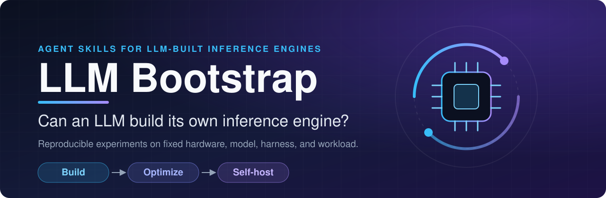
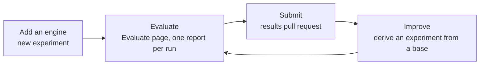

<div align="center">



<h1>LLM Bootstrap</h1>

**Agent skills and reproducible hill-climb data points for local LLM inference engines: one engine, one commit, one platform, one evaluation.**

[](docs/plugins.md)
[](docs/plugins.md)
[](#known-experimental-results)
[](package.json)

[Quick start](#quick-start) · [How it works](#how-it-works) · [Prior evidence](#known-experimental-results) · [Repository map](#repository-map) · [Plugin guide](docs/plugins.md)

</div>

---

## What is LLM Bootstrap?

LLM Bootstrap collects **hill-climb data points** for local LLM inference engines, and ships the agent skills to produce them. It works with **Agent Plugins 1.0** clients (such as VS Code) and **Claude Code**, loading the same skills and bundled resources in both.

Each data point is one engine at one commit, measured by a repository-owned evaluation on a fixed platform and target model. An experiment records only what makes data points comparable, and a report holds what was measured.

- **How an engine was written is not tracked.** An LLM, a person, vibe coding, or a published project may have produced it. The project records what the engine measures, not who wrote it.
- The engine may specialize aggressively for the chosen hardware and model. General-purpose engine coverage is not the objective.
- Every report is kept, regressions and failed checks included. There is no quality gate that hides a result.
- Platform-specific state-of-the-art performance is the **research target, not an established result**.
- The plugin ships agent instructions and templates, not executable hooks or MCP servers. Installing it does not run an experiment or authorize machine changes.

## Why this project exists

An LLM already runs on a substantial inference stack. Can it use that initial capability to write, validate, profile, and optimize the stack that will run its next inference?

[Infer.NET](https://github.com/LittleLittleCloud/Infer.NET) motivated this project by providing a concrete local engine and real application measurements. LLM Bootstrap separates the reusable method from any particular implementation, language, or hardware backend. An engine may be C++, Rust, C#, Metal, CUDA, or anything suited to its declared platform.

The path has three stages:

| Stage | Goal |
| --- | --- |
| **Assist** (now) | Closed-source LLMs or humans build an open model's inference engine and hill-climb it. Each step is a data point. |
| **Learn** (next) | The next open models learn the necessary techniques from this repository. |
| **Self-host** (goal) | An LLM completes its own inference engine. |

The experiments themselves do not require an LLM to write the engine, and a self-hosting claim is not something the data model records. It is made, with evidence, in a results pull request.

## How it works

An **experiment** is flat metadata: the platform, the target model, the pinned evaluation, the one engine with its commit, a comparison track, and goal thresholds. A **report** is one evaluation run of that engine. A hill-climb step is a new experiment that derives from the previous one and changes only what differs, usually the engine commit.



| Mode | Use it to |
| --- | --- |
| **Add an engine** | Start on a new platform, target model, or goal, with an engine at a commit. |
| **Evaluate** | Measure the engine an existing experiment names, with the Evaluate page. Nothing in the experiment changes. |
| **Improve** | Take the next step of a hill climb from a base experiment: a new commit, another engine, or a changed goal. A base experiment is required. |

A frozen `experiment.json` looks like this (hashes shortened):

```json
{
  "experiment_id": "m5pro-qwen36-a3b-8bit-001",
  "status": "frozen",
  "description": "Qwen3.6-35B-A3B 8bit on M5 Pro, endpoint-bench full profile.",
  "contract_frozen_at": "2026-10-31T09:00:00+08:00",
  "hardware_platform": "Apple M5 Pro",
  "hardware_gpu_cores": 20,
  "hardware_memory_gib": 48,
  "target_repository": "mlx-community/Qwen3.6-35B-A3B-8bit",
  "target_revision": "e06a74e6…",
  "target_weights": "affine8/group64",
  "evaluation_id": "endpoint-bench",
  "evaluation_revision": "<40-character commit>",
  "evaluation_sha256": "<64-character hash>",
  "engine_name": "my-engine",
  "engine_commit": "<40-character commit>",
  "comparison_track": "matched-configuration",
  "goal_thresholds": ["decode_tokens_per_second_p50 >= 100", "speed_ttft_ms_p50 <= 500"]
}
```

Reports sit beside it at `experiments/<id>/evaluation/<YYYYMMDD-HHMMSS>.json`. Everything else about the machine and the engine (toolchain, power mode, precision, memory and swap observed, how the endpoint was started) goes in the results pull request description, where a reviewer can challenge it.

## Quick start

### 1. Install the plugin

**Agent Plugins / VS Code**

Run **Chat: Install Plugin from Source** and enter:

```text
https://github.com/LittleLittleCloud/LLM-Bootstrap.git
```

Enable agent plugins if your client requires it. A supporting client discovers the root [manifest](plugin.json) and the skills automatically.

**Claude Code**

```text
/plugin marketplace add LittleLittleCloud/LLM-Bootstrap
/plugin install llm-bootstrap@llm-bootstrap-marketplace
```

For an unpublished local checkout, start Claude Code with `claude --plugin-dir /absolute/path/to/LLM-Bootstrap` instead.

Remote installation uses the published revision, not unpushed local changes. See the [plugin guide](docs/plugins.md) for complete commands, prerequisites, and verification.

Start a fresh session in your **experiment project**, not the plugin cache, and invoke `bootstrap-experiment-sop` from the client's skill menu. In Claude Code it is `/llm-bootstrap:bootstrap-experiment-sop`.

> Other harnesses may consume the skills directly if they preserve the entire repository layout. Copying only the skill files loses their shared resources. No Pi plugin auto-discovery integration is claimed here.

### 2. Pick a mode

The skill asks which mode applies. For example, on **Apple M5 Pro, 48 GiB with Qwen3.6-35B-A3B 8bit**:

> **Add an engine:** Use bootstrap-experiment-sop to add an engine. Create a new experiment directory in my project workspace for this machine and target model, with my engine at commit `<sha>`, then write and freeze its `experiment.json` there. Do not edit the installed plugin.

> **Evaluate:** Use bootstrap-experiment-sop to evaluate experiment `<experiment-id>`. My endpoint serves the engine at the commit it records; run the Evaluate page and save the report unchanged.

> **Improve:** Use bootstrap-experiment-sop to improve experiment `<experiment-id>`. Derive a new experiment from it that overrides `engine_commit` with my next commit, then evaluate it.

While `experiment.json` is being written, unresolved fields stay `null` and `status` is `draft-not-run`. Fill them before running. A draft is a planning artifact, not an executable configuration.

### 3. Evaluate and submit

Serve the engine at the recorded commit, run the `full` profile on the Evaluate page, and keep every report, including failed, interrupted, and regressed runs. Publish results with exact conditions and evidence access limitations; do not call unmatched measurements an optimization speedup. Submit them with the `bootstrap-submit-results` skill.

Use feature branches and pull requests for project changes. Merge requires explicit maintainer authorization. Preparing this repository does not start a hardware experiment.

## Repository map

| Path | Purpose |
| --- | --- |
| [plugin.json](plugin.json) | Agent Plugins 1.0 manifest; portable skills are discovered from the shared skills directory. |
| [.claude-plugin/plugin.json](.claude-plugin/plugin.json) | Claude Code manifest using the same skills and resources. |
| [.claude-plugin/marketplace.json](.claude-plugin/marketplace.json) | Single-plugin marketplace for installation and updates. |
| [skills/bootstrap-experiment-sop](skills/bootstrap-experiment-sop/SKILL.md) | Self-contained skill with three modes (add an engine, evaluate, improve). `references/` hold the modes, stages, both protocols, and prior evidence; `assets/` the schemas; `scripts/` the experiment check and resolver. |
| [skills/bootstrap-submit-results](skills/bootstrap-submit-results/SKILL.md) | Submits finished experiment results as a reviewable pull request, after a private-material scan and the repository's own validation. |
| [evaluations/](evaluations/endpoint-bench/evaluation.json) | Evaluation definitions and code owned by this repository; the skill takes them from the latest `main` commit. |
| [docs/plugins.md](docs/plugins.md) | Installation, compatibility, local development, and validation. |
| `site/` *(not in the plugin package)* | React and Vite site: a leaderboard with filters and a trend view, built from the submitted experiment records, and the Evaluate page. |
| `tools/leaderboard/build-index.mjs` *(not in the plugin package)* | Builds the leaderboard index. |

<details>
<summary><strong>Evaluation: <code>endpoint-bench</code></strong></summary>

`endpoint-bench` is released and modeled on ZebraBench. Give it an endpoint URL and an optional token, and the site's Evaluate page runs **conform, speed, thinking, decode, prefill, needle, and cache** in the browser and exports one report.

Evaluation code and scripts are defined by this repository under `evaluations/`; experiments and whoever writes an engine do not write or change them.

</details>

<details>
<summary><strong>Site and leaderboard</strong></summary>

- Run `npm install && npm run dev` inside `site/`.
- The site deploys to a Cloudflare Worker with static assets (`site/wrangler.jsonc`). In Workers Builds, set the root directory to `site` and the build command to `npm ci && npm run build`.
- `tools/leaderboard/build-index.mjs` builds the index from `experiments/<id>/experiment.json` and every `experiments/<id>/evaluation/<YYYYMMDD-HHMMSS>.json` report, checking every pinned hash and, when Ajv is installed, every schema.
- Every report is listed and ranked, regressions included. The conformance result is shown beside the metrics and does not filter them.
- `site/public/data/leaderboard.json` is the index built from `experiments/`. It is committed, and a test fails when it is stale: rebuild it with `node tools/leaderboard/build-index.mjs . --out site/public/data/leaderboard.json --require-validation`. The site shows no data until a results pull request adds records.

</details>

This repository does not yet ship an inference engine, an automated experiment runner, or a validated SOTA result.

## Known experimental results

These are **prior application measurements from Infer.NET**, measured on 2026-10-24. They were not produced by the skills in this repository and are not experiments in this repository's format.

Both records use M5 Pro / 48 GiB, `mlx-community/Qwen3.6-35B-A3B-8bit` at revision `e06a74e6236a60c8367e1a3214e83d8b61b637b0`, Pi 1.4.0, and the same fixed 20 HumanEval tasks.

| Prior run | Official assertions | Reported prefill | Reported decode | Pi task time |
| --- | --- | --- | --- | --- |
| [Infer.NET, fully local](https://github.com/LittleLittleCloud/Infer.NET/blob/4ca29eed1a2acb8a870d33e980dce37dfbc1b7e3/docs/EXPERIMENT-58-M5PRO-HUMAN20-20261024.md) | 20/20 | 268.205 tok/s | 66.434 tok/s, N−1 intervals | 1,202.992 s |
| [Splash, full residency](https://github.com/LittleLittleCloud/Infer.NET/blob/4ca29eed1a2acb8a870d33e980dce37dfbc1b7e3/docs/EXPERIMENT-61-SPLASH-HUMAN20-20261024.md) | 20/20 | 3,066.611 tok/s, native command timing | 148.914 tok/s, native command timing | 270.630 s |

> [!WARNING]
> **These rows are not a controlled engine speedup comparison.** Infer.NET used FP32 KV/state and no speculative decoding; Splash used Q8 KV, FP32 recurrent state, and a DFlash2 draft model. Work generated different request token totals, timing boundaries differ, and Splash required a raised GPU memory limit. Both recorded whole-machine swap-out. Splash first failed to start under the default budget; that failure is retained in the source record.

See [prior evidence](skills/bootstrap-experiment-sop/references/prior-evidence.md) for versions, metric definitions, resource observations, and public evidence links. HumanEval task correctness is not cross-backend numerical equivalence or long-context acceptance.

**No experiment under the LLM Bootstrap protocol has been completed yet; platform SOTA remains unverified.**

## What counts as success?

Each experiment fixes its `goal_thresholds` before its first evaluation, as `metric >= value` or `metric <= value` on headline metrics of the evaluation report, such as decode throughput or time to first token. A report that misses a threshold is still recorded and listed.

Comparisons are made between experiments that share a platform, a target model, and an evaluation. A derived experiment inherits those, so the conditions match by construction. Matched-configuration and best-permitted-configuration comparisons stay separate tracks.

A SOTA claim requires a credible search for strong current reference engines, matched conditions or clearly separated comparison tracks, reproducible measurements, and stated workload boundaries. A result on one model and platform supports that configuration only. See the [experiment protocol](skills/bootstrap-experiment-sop/references/experiment-protocol.md) and [evaluation protocol](skills/bootstrap-experiment-sop/references/evaluation-protocol.md) for the full reporting contract.

## Contributing

Use feature branches with the `codex/` prefix and pull requests; merge only with explicit maintainer authorization. Do not publish model weights, credentials, private prompts, or unreviewed agent transcripts; record artifact hashes and access limitations instead. Run `npm test` before submitting. Finished experiment results go through the [bootstrap-submit-results](skills/bootstrap-submit-results/SKILL.md) skill.

---

<sub>**Keywords:** LLM inference engine, hill climbing, inference optimization, local LLM, agent skills, Claude Code plugin, Agent Plugins, VS Code agent plugin, Apple Silicon MLX, Qwen3.6, HumanEval, LLM benchmark, reproducible experiments, vibe coding.</sub>
