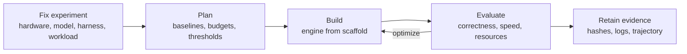

<div align="center">

# LLM Bootstrap

### Can an LLM build its own inference engine?

**Agent skills and reproducible experiment protocols for LLM-built inference engines: plan, build, optimize, and evaluate on fixed hardware, model, and workload.**

[](docs/plugins.md)
[](docs/plugins.md)
[](#known-experimental-results)
[](package.json)

[Quick start](#quick-start) · [How it works](#how-it-works) · [Prior evidence](#known-experimental-results) · [Repository map](#repository-map) · [Plugin guide](docs/plugins.md)

</div>

---

## What is LLM Bootstrap?

LLM Bootstrap is an agent skills plugin for **LLM inference engine development**. It works with **Agent Plugins 1.0** clients (such as VS Code) and **Claude Code**, loading the same skills and bundled experiment resources in both.

Each experiment fixes one configuration: **hardware + target model + agent harness + workload**. It supplies the skills and a measurable goal, then studies whether an LLM agent can build an inference engine that competes with the strongest verified baselines on that specific platform.

- The engine may specialize aggressively for the chosen hardware and model. General-purpose engine coverage is not the objective.
- Platform-specific state-of-the-art performance is the **research target, not an established result**.
- The plugin ships agent instructions and experiment templates, not executable hooks or MCP servers. Installing it does not run an experiment or authorize machine changes.

## Why this project exists

An LLM already runs on a substantial inference stack. Can it use that initial capability to write, validate, profile, and optimize the stack that will run its next inference?

[Infer.NET](https://github.com/LittleLittleCloud/Infer.NET) motivated this project by providing a concrete local engine and real application measurements. LLM Bootstrap separates the reusable experimental method from any particular implementation, language, or hardware backend. A run may produce C++, Rust, C#, Metal, CUDA, or another implementation suited to its declared platform.

## How it works

The research has three levels:

| Level | Goal |
| --- | --- |
| **1. Build** | Produce a functioning engine with validated model execution. |
| **2. Optimize** | Use measurements to approach or exceed strong baselines under a fixed correctness and resource contract. |
| **3. Self-host** | Run the builder LLM through the resulting engine and continue development, preserving a traceable record of the transition. |



The initial LLM, operating system, compiler, hardware, and permitted libraries are declared inputs. "Autonomous" refers to implementation and optimization decisions within that environment. Human interventions and pre-existing engine code are recorded. If the builder LLM differs from the target model, the experiment studies engine construction; it does not yet demonstrate self-hosting.

## Quick start

### 1. Install the plugin

**Agent Plugins / VS Code**

Run **Chat: Install Plugin from Source** and enter:

```text
https://github.com/LittleLittleCloud/LLM-Bootstrap.git
```

Enable agent plugins if your client requires it. A supporting client discovers the root [manifest](plugin.json) and the skills automatically.

**Claude Code**

```text
/plugin marketplace add LittleLittleCloud/LLM-Bootstrap
/plugin install llm-bootstrap@llm-bootstrap-marketplace
```

For an unpublished local checkout, start Claude Code with `claude --plugin-dir /absolute/path/to/LLM-Bootstrap` instead.

Remote installation uses the published revision, not unpushed local changes. See the [plugin guide](docs/plugins.md) for complete commands, prerequisites, and verification.

Start a fresh session in your **experiment project**, not the plugin cache, and invoke `bootstrap-experiment-sop` from the client's skill menu. In Claude Code it is `/llm-bootstrap:bootstrap-experiment-sop`.

> Other harnesses may consume the skills directly if they preserve the entire repository layout. Copying only the skill files loses their shared resources. No Pi plugin auto-discovery integration is claimed here.

### 2. Fix the experiment and goal

Example: **Apple M5 Pro, 48 GiB + Qwen3.6-35B-A3B 8bit + Pi 1.4.0**, with a fixed HumanEval workload and explicit correctness, memory, and latency requirements. This tuple identifies a starting point; it is insufficient until revisions, builder identity, baseline settings, budgets, and thresholds are filled in.

While `experiment.json` is being written, unresolved fields stay `null` and `status` is `draft-not-run`. Fill them before running. A draft is a planning artifact, not an executable configuration. Distinguish the harness driving engine development from the harness evaluating the resulting endpoint, even if both use Pi.

Then give the agent a task such as:

> Use bootstrap-experiment-sop to start a new experiment: create a new experiment directory in my project workspace, then write and freeze its `experiment.json` there. Do not edit the installed plugin. After the essential fields and execution authorization are resolved, follow its build and evaluation stages to build a local inference engine specialized for this machine and target model. Measure it against the baselines named in the experiment. Preserve correctness and resource limits; retain failed attempts and record every human intervention. Work within the declared budget. Attempt self-hosting only if the builder identity and model support make it possible and it is included in the experiment scope.

### 3. Build, measure, and retain evidence

Start from a declared scaffold or empty engine directory. Keep the skills revision, implementation commits, commands, profiles, correctness results, per-request timings, failures, and agent trajectory. Run competing engines serially on the same hardware. Publish results with exact configurations and evidence access limitations; do not call unmatched measurements an optimization speedup.

Use feature branches and pull requests for project changes. Merge requires explicit maintainer authorization. Preparing this repository does not start a hardware experiment.

## Repository map

| Path | Purpose |
| --- | --- |
| [plugin.json](plugin.json) | Agent Plugins 1.0 manifest; portable skills are discovered from the shared skills directory. |
| [.claude-plugin/plugin.json](.claude-plugin/plugin.json) | Claude Code manifest using the same skills and resources. |
| [.claude-plugin/marketplace.json](.claude-plugin/marketplace.json) | Single-plugin marketplace for installation and updates. |
| [skills/bootstrap-experiment-sop](skills/bootstrap-experiment-sop/SKILL.md) | Self-contained skill that runs a new or derived experiment end to end. `references/` hold the stages, both protocols, and prior evidence; `assets/` the schemas; `scripts/` the experiment check and resolver. |
| [skills/bootstrap-submit-results](skills/bootstrap-submit-results/SKILL.md) | Submits finished experiment results as a reviewable pull request, after a private-material scan and the repository's own validation. |
| [evaluations/](evaluations/endpoint-bench/evaluation.json) | Evaluation definitions and code owned by this repository; the skill takes them from the latest `main` commit. |
| [docs/plugins.md](docs/plugins.md) | Installation, compatibility, local development, and validation. |
| `site/` *(not in the plugin package)* | React and Vite site: a leaderboard with filters and a trend view (currently synthetic demo data) and the Evaluate page. |
| `tools/leaderboard/build-index.mjs` *(not in the plugin package)* | Builds the leaderboard index. |

<details>
<summary><strong>Evaluation: <code>endpoint-bench</code></strong></summary>

`endpoint-bench` is released and modeled on ZebraBench. Give it an endpoint URL and an optional token, and the site's Evaluate page runs **conform, speed, thinking, decode, prefill, needle, and cache** in the browser and exports one report.

Evaluation code and scripts are defined by this repository under `evaluations/`; experiments and builder LLMs do not write or change them.

</details>

<details>
<summary><strong>Site and leaderboard</strong></summary>

- Run `npm install && npm run dev` inside `site/`.
- The site deploys to a Cloudflare Worker with static assets (`site/wrangler.jsonc`). In Workers Builds, set the root directory to `site` and the build command to `npm ci && npm run build`.
- `tools/leaderboard/build-index.mjs` builds the index from `experiments/<id>/experiment.json` and every `experiments/<id>/evaluation/<subject>/<YYYYMMDD-HHMMSS>.json` report, checking every pinned hash and, when Ajv is installed, every schema.
- `site/public/data/leaderboard.mock.json` is a static synthetic index; a real `site/public/data/leaderboard.json` takes precedence when present.

</details>

This repository does not yet ship an inference engine, an automated experiment runner, or a validated SOTA result.

## Known experimental results

These are **prior application measurements from Infer.NET**, measured on 2026-10-24. They were not produced by the skills in this repository and do not establish autonomous construction or self-hosting.

Both records use M5 Pro / 48 GiB, `mlx-community/Qwen3.6-35B-A3B-8bit` at revision `e06a74e6236a60c8367e1a3214e83d8b61b637b0`, Pi 1.4.0, and the same fixed 20 HumanEval tasks.

| Prior run | Official assertions | Reported prefill | Reported decode | Pi task time |
| --- | --- | --- | --- | --- |
| [Infer.NET, fully local](https://github.com/LittleLittleCloud/Infer.NET/blob/4ca29eed1a2acb8a870d33e980dce37dfbc1b7e3/docs/EXPERIMENT-58-M5PRO-HUMAN20-20261024.md) | 20/20 | 268.205 tok/s | 66.434 tok/s, N−1 intervals | 1,202.992 s |
| [Splash, full residency](https://github.com/LittleLittleCloud/Infer.NET/blob/4ca29eed1a2acb8a870d33e980dce37dfbc1b7e3/docs/EXPERIMENT-61-SPLASH-HUMAN20-20261024.md) | 20/20 | 3,066.611 tok/s, native command timing | 148.914 tok/s, native command timing | 270.630 s |

> [!WARNING]
> **These rows are not a controlled engine speedup comparison.** Infer.NET used FP32 KV/state and no speculative decoding; Splash used Q8 KV, FP32 recurrent state, and a DFlash2 draft model. Work generated different request token totals, timing boundaries differ, and Splash required a raised GPU memory limit. Both recorded whole-machine swap-out. Splash first failed to start under the default budget; that failure is retained in the source record.

See [prior evidence](skills/bootstrap-experiment-sop/references/prior-evidence.md) for versions, metric definitions, resource observations, and public evidence links. HumanEval task correctness is not cross-backend numerical equivalence or long-context acceptance.

**No experiment under the LLM Bootstrap protocol has been completed yet; platform SOTA and self-hosting remain unverified.**

## What counts as success?

Success is defined per experiment before tuning:

- quality and correctness gates;
- prefill/decode and client latency objectives;
- memory constraints;
- a fixed compute and time budget.

Report the gap to named, dated baselines alongside agent cost and human assistance.

A SOTA claim requires a credible search for strong current baselines, matched conditions or clearly separated comparison tracks, reproducible measurements, and stated workload boundaries. A result on one model and platform supports that configuration only. See the [experiment protocol](skills/bootstrap-experiment-sop/references/experiment-protocol.md) and [evaluation protocol](skills/bootstrap-experiment-sop/references/evaluation-protocol.md) for the full reporting contract.

## Contributing

Use feature branches with the `codex/` prefix and pull requests; merge only with explicit maintainer authorization. Do not publish model weights, credentials, private prompts, or unreviewed agent transcripts; record artifact hashes and access limitations instead. Run `npm test` before submitting. Finished experiment results go through the [bootstrap-submit-results](skills/bootstrap-submit-results/SKILL.md) skill.

---

<sub>**Keywords:** LLM inference engine, LLM-built inference engine, self-hosting LLM, autonomous coding agent, agent skills, Claude Code plugin, Agent Plugins, VS Code agent plugin, Apple Silicon MLX, Qwen3.6, HumanEval, LLM benchmark, inference optimization, reproducible experiments.</sub>
